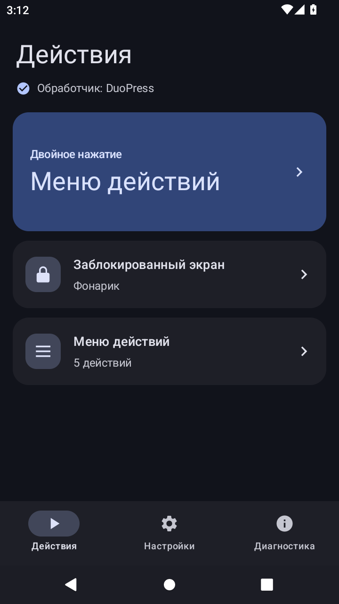
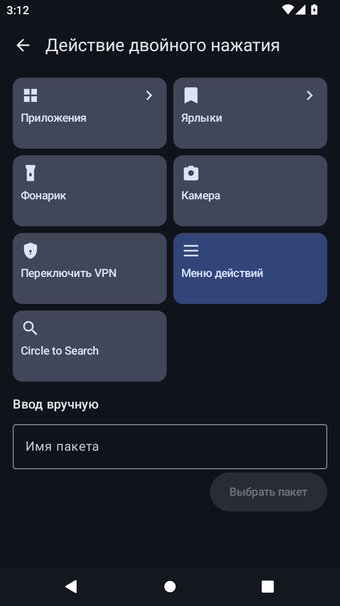
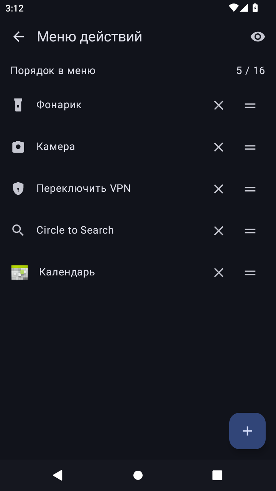
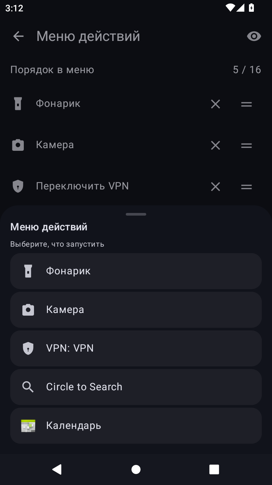

# DuoPress

**Двойное нажатие кнопки питания — для того, что нужно вам.**

DuoPress переназначает жест, которым **vivo** и **iQOO** с **OriginOS** открывают Vivo Wallet. Вместо кошелька можно запускать **Mir Pay**, **СБПэй**, другое приложение или быстрое действие. Для обычных действий не нужны root, Shizuku или удаление системного кошелька.

**[Собрать DuoPress](#сборка-и-тесты)** · **[Релизы](https://github.com/januarydayfin/OriginOs-DuoPress/releases)** · **[Быстрая настройка](#быстрая-настройка)** · **[Архитектура](#архитектура)**

## Скриншоты

| Действия | Выбор действия | Редактор меню | Панель действий |
| :---: | :---: | :---: | :---: |
| <a href="docs/screenshots/actions.png"></a> | <a href="docs/screenshots/action-picker.png"></a> | <a href="docs/screenshots/menu-editor.png"></a> | <a href="docs/screenshots/action-menu.png"></a> |

Интерфейс debug-сборки на Android-эмуляторе, не проверка жеста на OriginOS. Нажмите на изображение, чтобы увеличить его.

## Возможности

- **Открыть приложение или ярлык.** Найдите установленное приложение по названию или пакету либо введите имя пакета вручную. Для ярлыков поддерживаются статические, динамические и закреплённые shortcuts.
- **Запустить быстрое действие.** Переключите фонарик, откройте камеру или переключите подключение **Happ** либо **incy** в фоне.
- **Выбрать отдельное действие для экрана блокировки.** Назначьте фонарик или камеру. Если отдельное действие выключено, DuoPress попробует выполнить основное.
- **Собрать своё меню.** Добавьте до 16 действий, приложений и ярлыков. Меняйте порядок перетаскиванием за ручку с тактильным откликом и смотрите результат в предпросмотре.
- **Настроить отклик и проверить запуск.** В **«Настройках»** доступны вибрация и выбор VPN-клиента. **«Диагностика»** показывает обработчик жеста и журнал последнего запуска; тест в приложении не проверяет физическую кнопку.

Интерфейс на Material 3 следует светлой или тёмной теме системы, поддерживает динамические цвета на Android 12+ и доступен на русском и английском.

## Совместимость

- **Android 7.1+ (API 25)** — минимальная версия для установки. Сам жест работает на сборках OriginOS, которые отправляют системный вызов Vivo Wallet и позволяют выбрать сторонний обработчик. Это зависит от прошивки.
- **Ярлыки приложений** требуют **Android 11+** и [Shizuku](https://shizuku.rikka.app/) **с API 13+**, запущенного через ADB или беспроводную отладку от имени `shell`. Нужно выдать DuoPress разрешение в Shizuku. Запуск Shizuku от root и Sui не поддерживаются. Остальные действия от Shizuku не зависят.
- На **Android 11** система может отклонить запуск ярлыка, если приложение-владелец не открыто. Журнал подтверждает отправку запроса, а не появление окна.
- DuoPress **не меняет приложение бесконтактной оплаты по умолчанию**. Запуск Mir Pay по кнопке и выбор платёжного приложения в Android — разные настройки.

## Быстрая настройка

1. Установите APK DuoPress из релиза или соберите его по инструкции ниже. На телефоне включите **«Дважды нажмите кнопку питания»** в **Настройки → Другие сети и подключения → NFC** или в Vivo Wallet. Названия пунктов могут отличаться в зависимости от версии OriginOS.
2. В **DuoPress → Действия → Двойное нажатие** выберите, что запускать. В соседних карточках можно настроить экран блокировки и состав меню.
3. Нажмите **«Настроить кнопку»**, если кнопка доступна, или дважды нажмите кнопку питания. Если OriginOS покажет выбор приложений, выберите **DuoPress → Всегда**. Если открывается другой обработчик, сначала сбросьте его назначение по умолчанию в системных настройках.
4. Проверьте жест на телефоне. При необходимости откройте **«Диагностику»**, чтобы посмотреть, в какое приложение система направляет вызов и что записалось в журнал.

> APK из релиза **Double Power Key 2.2.0** относится к прежнему приложению. DuoPress (`com.krayapp.duopress`) устанавливается отдельно; настройки и разрешение Shizuku не переносятся.

## Архитектура

Один Android-модуль `:app`, код на Kotlin. Настройка и выполнение жеста — два отдельных потока:

| Поток | Как устроен |
| --- | --- |
| **Настройка** | [`MainActivity`](app/src/main/kotlin/com/krayapp/duopress/MainActivity.kt) и [`AppNavHost`](app/src/main/kotlin/com/krayapp/duopress/ui/navigation/AppNavHost.kt) показывают три вкладки и вложенные экраны на Compose. Экранные ViewModel принимают пользовательские события и отдают `UiState` через `StateFlow` (MVI). [`SettingsRepository`](app/src/main/kotlin/com/krayapp/duopress/data/SettingsRepository.kt) опирается на общее хранилище `SharedPreferences`. |
| **Выполнение жеста** | OriginOS отправляет `vivo.intent.action.NFC_BUS_SWINGSPLASH`. Прозрачная [`SwipeEntryActivity`](app/src/main/kotlin/com/krayapp/duopress/SwipeEntryActivity.kt) читает настройки, учитывает блокировку и передаёт выбранное действие в [`ActionRunner`](app/src/main/kotlin/com/krayapp/duopress/ActionRunner.kt), не открывая главный экран. Если выбрано меню, [`MenuActivity`](app/src/main/kotlin/com/krayapp/duopress/MenuActivity.kt) показывает панель в отдельном окне и запускает её пункты через тот же исполнитель. |

[`AppDependencies`](app/src/main/kotlin/com/krayapp/duopress/AppDependencies.kt) собирает зависимости вручную. Адаптеры в [`platform/`](app/src/main/kotlin/com/krayapp/duopress/platform/) отвечают за каталог приложений, системные статусы, внешние запросы и доступ к ярлыкам. Объявление обработчика и метаданные Vivo находятся в [`AndroidManifest.xml`](app/src/main/AndroidManifest.xml).

## Сборка и тесты

Нужны **JDK 17+**, **Android SDK 36** и указанный путь к SDK: переменная `ANDROID_HOME` или `sdk.dir` в `local.properties`. Gradle уже подключён через Wrapper.

```bash
bash gradlew :app:assembleDebug
bash gradlew :app:assembleRelease
bash gradlew :app:testDebugUnitTest :app:lintDebug
bash gradlew :app:connectedDebugAndroidTest  # эмулятор или устройство
```

APK появятся в `app/build/outputs/apk/`. Debug-сборка устанавливается отдельно (`com.krayapp.duopress.debug`). Локальная release-сборка без настроенного собственного ключа подписывается debug-ключом; переменные для подписи указаны в [`app/build.gradle`](app/build.gradle). [Матрица проверок миграции](docs/superpowers/plans/2026-11-25-kotlin-compose-mvi-verification.md) показывает, какие сценарии требуют реального vivo или iQOO.

## English

DuoPress remaps the power-button double press on supported vivo and iQOO phones running OriginOS. Open an app or shortcut, toggle the flashlight or Happ/incy VPN, launch the camera, or show a customizable action menu. You can assign a separate flashlight or camera action to the lock screen. The app supports Android 7.1+; only app shortcuts require Android 11+ and Shizuku API 13+ running as `shell`. The in-app test does not exercise the physical button.

On Android 11, the system may block a shortcut launch when its app is not open. The log confirms the request, not that the window appeared.

## Лицензия

[MIT](LICENSE)
